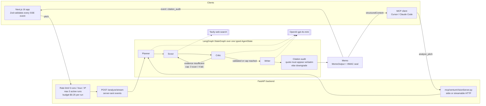
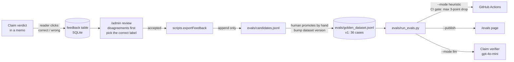

# VentureVision

**A multi-agent due diligence engine that researches a startup idea on the live web and writes an evidence-grounded investment memo, streamed to the browser in real time.**

[](https://github.com/gautamrn/VentureVision/actions/workflows/ci.yml)
[](https://www.python.org/)
[](https://fastapi.tiangolo.com/)
[](https://langchain-ai.github.io/langgraph/)
[](https://nextjs.org/)
[](https://react.dev/)
[](https://www.typescriptlang.org/)
[](https://docs.pydantic.dev/)
[](https://zod.dev/)

<!--
  PORTFOLIO TODO (delete this block when done):
  1. Add your live demo link here:  **[Live demo →](https://your-app.vercel.app)**
  2. Capture screenshots and save them under docs/screenshots/, then uncomment the Screenshots section below.
-->

---

## Table of Contents

1. [What It Is](#what-it-is)
2. [Why I Built It](#why-i-built-it)
3. [Features](#features)
4. [System Architecture](#system-architecture)
5. [The Agent Pipeline, Step by Step](#the-agent-pipeline-step-by-step)
6. [Data Integrity: How It Avoids Hallucination](#data-integrity-how-it-avoids-hallucination)
7. [Real-Time Streaming Contract](#real-time-streaming-contract)
8. [API Reference](#api-reference)
9. [Type Safety End to End](#type-safety-end-to-end)
10. [Frontend](#frontend)
11. [Observability](#observability)
12. [Evaluation](#evaluation)
13. [Reliability and Abuse Protection](#reliability-and-abuse-protection)
14. [Tech Stack](#tech-stack)
15. [Project Structure](#project-structure)
16. [Getting Started](#getting-started)
17. [Configuration](#configuration)
18. [Deployment](#deployment)
19. [Design Decisions and Tradeoffs](#design-decisions-and-tradeoffs)
20. [Known Limitations and Roadmap](#known-limitations-and-roadmap)
21. [What I Learned](#what-i-learned)

---

## What It Is

You paste in a startup idea or pitch (40 to 5,000 characters). VentureVision then runs four cooperating AI agents:

1. A **Planner** turns the pitch into targeted web search queries.
2. A **Scout** runs those searches and collects real sources.
3. A **Critic** audits whether the evidence is good enough and, if not, sends the Scout back out with sharper queries.
4. A **Writer** synthesizes a structured memo that cites only what was actually found.

You watch the pipeline work live (which agent is running, how many sources were found, how well the evidence covers the plan), and you end up with a scored memo containing a competitor table, risk vectors, investor questions, an annotated copy of your own pitch, deal context, and a list of every source consulted.

It is a **data-retrieval and synthesis engine**, not a creative writing tool. Every claim in the output is meant to be traceable to a URL.

<!--
## Screenshots

| Landing | Live agent progress | Memo |
|---|---|---|
|  |  |  |

| Pitch annotations | Side-by-side compare | Observability |
|---|---|---|
|  |  |  |
-->

## Why I Built It

Most LLM "startup analyzers" are a single prompt wrapped in a UI. They sound confident, invent competitors, and cite nothing. Due diligence is the opposite discipline: **a single verified data point is worth more than paragraphs of reasoning**.

I wanted to build something that treats the LLM as one component in a pipeline that is *forced* to be honest:

- Research happens **before** writing, using live search, not model memory.
- A separate agent **audits** the evidence and can reject it.
- The writer is instructed to say "not found in evidence" rather than fill gaps.
- Every output field is validated against a schema, on both the server and the client.

The project is also a practical study in agent orchestration: cyclic graphs, shared typed state, streaming partial results, graceful degradation when a model or API call fails, and operating a public LLM endpoint without burning through credits.

## Features

### Two analysis modes

| | **Market Scan** | **Pitch Lab** |
|---|---|---|
| **Purpose** | Brainstorming: "Is this worth building? Who else is in this space?" | Pitch sharpening: "Make my pitch land with investors." |
| **Planner output** | Exactly 4 queries (hard-capped in code) | 6 to 8 queries targeting market figures, named competitors, comparable models, and regulatory gaps |
| **Critic loop cap** | 3 evaluations | 4 evaluations |
| **Score meaning** | Opportunity signal (how much evidence backs the market) | Pitch readiness (how investor-ready the text is, given the evidence) |
| **Tone** | Curious research notes from a smart friend | Direct pitch coaching with concrete rewrites |
| **Annotations** | At least 4, types `strong` / `needs_research` | At least 6, types `strong` / `weak_claim` / `vague` / `unsubstantiated`, each with a suggested rewrite |

### Memo contents

- **Pitch score (0 to 100)** with four weighted subscores: market size (30%), competition (25%), revenue model (25%), uniqueness (20%)
- **Executive summary** (2 to 3 sentences)
- **Competitive landscape table** (competitor, pricing, funding; unknown values are literally `not found in evidence`)
- **Risk vectors**
- **Investor Q&A** with a "why it matters" for each question
- **Pitch annotations**: your original text highlighted inline by how an investor would read it
- **Strengthen-your-pitch suggestions** and **feature suggestions** drawn from competitor offerings
- **Deal context**: typical stage, raise range, dilution, and red flags
- **Research confidence** (0 to 100%) and the **full source list**

### Product extras

- Live four-stage progress bar fed by server-sent events
- Past analyses saved in the browser (last 20), with delete
- Side-by-side comparison of any two past analyses
- One-click **Copy as Markdown** export of the whole memo, plus per-section copy buttons
- Protected admin observability dashboard

## System Architecture



Every node also streams its partial output (`planner`, `evidence`, `scout`, `critic`, `writer` events), so the browser shows real progress. The MCP server calls the same graph directly and reports each finished node as an MCP progress notification.

### The evaluation loop



**The key idea:** the agents are nodes in a *cyclic* graph that all read and write one shared, typed `AgentState`. LangGraph executes the graph on a worker thread and yields each node's output as it finishes. The API forwards each of those outputs to the browser as an SSE event, which is why the UI can show real progress instead of a spinner.

## The Agent Pipeline, Step by Step

Think of the pipeline as a small research team. Each member has exactly one job, and they hand work to each other through a shared notebook (the `AgentState`).

### The shared notebook: `AgentState`

Before any agent runs, it helps to know what they share. Defined in [`backend/app/graph/state.py`](backend/app/graph/state.py):

```python
class AgentState(TypedDict):
    pitch: str
    mode: str                        # "market_scan" | "pitch_lab"
    research_plan: list[str]         # queries written by the Planner
    raw_evidence: list[EvidenceItem] # sources gathered by the Scout
    analysis_iteration: int          # how many audit rounds have run
    is_validated: bool               # the Critic's verdict
    critique_feedback: str           # new queries the Critic wants run
    coverage_score: float            # 0.0 to 1.0
    final_memo: MemoOutput | None    # the Writer's finished product
```

> **Why it matters:** one explicit state type means any node can be changed without guessing what the others expect. The project convention is to update `AgentState` first whenever a node's inputs or outputs change.

### Step 1: Planner (`nodes/planner.py`)

**Job:** convert a vague idea into searches that return real data.

A student who types "dog walking market" into Google gets generic blog posts. A good researcher types "Rover Wag funding round valuation 2024". The Planner is prompted to do the second thing: pull out product names, company names, and industry terms from the pitch, add years for recency, and split the queries across themes (competitors, market size, business model, problem space).

- Uses `gpt-4o-mini` at `temperature=0` with **structured output** bound to a Pydantic `ResearchPlan`, so the response is a validated `list[str]` and never free text to be parsed.
- Prompts include explicit GOOD vs. BAD query examples, to steer the model toward specific, searchable phrasing.
- **Fallback:** if the LLM call fails, it builds four generic queries from the first six words of the pitch, so the run continues rather than crashing.

### Step 2: Scout (`nodes/scout.py`)

**Job:** go get the evidence. This node performs no reasoning; it is pure retrieval.

For each query it calls [Tavily](https://tavily.com) (`max_results=2`, `include_answer=True`) and stores each hit as an `EvidenceItem` (query, title, snippet, `source_url`).

- Snippets are truncated to 800 characters. If a snippet is under 200 characters, Tavily's short summary is appended to give the Writer more to work with.
- A failed query is skipped instead of aborting the run.
- **On a return trip:** if the Critic left feedback, the Scout runs *those* queries (capped at 4) instead of the original plan, and **appends** to the existing evidence rather than replacing it. Knowledge accumulates across rounds.

### Step 3: Critic (`nodes/critic.py`)

**Job:** be the skeptical reviewer. Is the evidence actually enough?

The Critic reads the research plan and a compact view of the evidence, then returns a structured `CritiqueResult`:

- `coverage_score`: what fraction of the plan's queries produced meaningful results
- `is_sufficient`: true when coverage is at least 0.8
- `feedback`: if insufficient, **2 to 4 new, ready-to-run search queries** (comma-separated), not prose like "missing pricing data"

That last point is deliberate. By forcing the feedback to be *executable queries*, the Critic's output plugs straight back into the Scout with no translation step.

**Termination is guaranteed.** The Critic increments `analysis_iteration` on each pass and force-approves once the cap is hit (3 in Market Scan, 4 in Pitch Lab). If its own LLM call errors, it approves and moves on. A cyclic graph without a hard stop is a runaway cost bug, so the cap is enforced in code, not left to the model's judgment.

### Step 4: Routing (`graph/workflow.py`)

This is where the graph becomes a *loop*. A conditional edge reads one field and decides where to go next:

```python
def routeAfterCritic(state: AgentState) -> str:
    if state.get("is_validated", False):
        return "writer"
    return "scout"
```

The full topology is `START → planner → scout → critic → (scout | writer) → END`. The graph is compiled once at import time (`ventureGraph`) and reused for every request.

### Step 5: Writer (`nodes/writer.py`)

**Job:** turn evidence into a memo, and refuse to go beyond it.

The Writer receives the original pitch plus every collected source (URL, query, title, content) and produces a structured `MemoSynthesis`. Mode selects the prompt: `QUICK_CHECK_PROMPT` for Market Scan, `PITCH_LAB_PROMPT` for Pitch Lab.

Two details worth noting:

- **Citations are not generated by the model.** `citation_links` is computed in code as the de-duplicated set of source URLs the Scout actually retrieved. The LLM cannot invent a link.
- **Failure is explicit.** If synthesis fails, the node returns `final_memo = None` and the API responds with HTTP 502 rather than a half-made memo.

## Data Integrity: How It Avoids Hallucination

Hallucination isn't solved by one trick. It is reduced by layering several constraints, each of which fails differently:

| Layer | Mechanism | Where |
|---|---|---|
| **Retrieval first** | Writing only happens after live search; the model is never asked to recall market facts | graph topology |
| **Independent audit** | A separate Critic judges coverage and can force more research | `critic.py` |
| **Explicit gap language** | Unknown pricing/funding must read `not found in evidence`; unsupported pitch claims must be annotated `unsubstantiated` and listed as risks | `EVIDENCE_RULES` in `writer.py` |
| **Banned hedges** | Prompt forbids "based on my knowledge", "typically", "generally": phrases that signal recall rather than evidence | `writer.py` |
| **Evidence-anchored scoring** | Score anchors tie each band (e.g. 80 to 100) to the strength of cited evidence; Pitch Lab bans hype words like "promising" and "innovative" | `writer.py` |
| **Code-generated citations** | Source list is built from retrieved URLs, never LLM output | `writer.py` |
| **Schema enforcement** | `HttpUrl` on every source, Pydantic structured output on every LLM call, Zod on every client-side event | `models.py`, `types.ts` |
| **Temperature 0** | Deterministic-leaning decoding for all three LLM nodes | all nodes |

> **Honest caveat:** these are prompt-level and structural controls, not a formal guarantee. The Writer's adherence to "evidence only" is instructed and constrained, but not mechanically verified (e.g. there is no post-hoc check that every competitor name appears in a snippet). That is the first item on the roadmap.

## Real-Time Streaming Contract

`POST /analyze/stream` returns a `text/event-stream`. Each LangGraph node emits one event named after the node, with a small JSON payload (built by `serializeNodeOutput` in `routers/analyze.py`):

```text
event: planner
data: {"queries": ["...", "..."], "queryCount": 4}

event: scout
data: {"evidenceCount": 8}

event: critic
data: {"iteration": 1, "isValidated": false, "coverageScore": 0.5, "feedback": "query one, query two"}

event: scout
data: {"evidenceCount": 14}

event: critic
data: {"iteration": 2, "isValidated": true, "coverageScore": 0.85, "feedback": ""}

event: writer
data: {"memo": { ...full MemoOutput... }}
```

(`error` events carry `{"message": "..."}`.)

**How the bridge from sync to async works.** LangGraph's `.stream()` is synchronous, but FastAPI is async. The route runs the graph in a daemon thread and pushes each chunk into an `asyncio.Queue` via `loop.call_soon_threadsafe`. The async generator drains the queue and yields SSE events. This keeps the event loop free for other requests while a 30 to 60 second analysis is in flight.

**On the client**, `streamAnalysis()` in [`frontend/src/lib/api.ts`](frontend/src/lib/api.ts) reads the response body with a `ReadableStream` reader, reassembles lines across chunk boundaries with a rolling buffer, and passes each event through a Zod schema before it touches React state. A malformed event is dropped instead of crashing the UI.

## API Reference

| Method | Path | Auth | Description |
|---|---|---|---|
| `GET` | `/health` | none | Liveness check, returns `{"status": "ok"}` |
| `POST` | `/analyze/stream` | rate-limited | Runs the pipeline and streams SSE events (primary path used by the UI) |
| `POST` | `/analyze` | rate-limited | Runs the pipeline and returns the whole result as one `RunResponse` JSON body |
| `GET` | `/admin/metrics` | `X-Admin-Key` header | Aggregate pipeline metrics (see [Observability](#observability)) |

**Request body** (`PitchRequest`):

```json
{
  "pitch": "We are building ... (40 to 5000 characters)",
  "mode": "market_scan"
}
```

`mode` is `"market_scan"` (default) or `"pitch_lab"`. Anything else fails validation with a `422`.

**Status codes**

| Code | Meaning |
|---|---|
| `200` | Success |
| `403` | Missing or wrong admin key (`/admin/metrics`). If `ADMIN_KEY` is unset, the endpoint is locked for everyone |
| `422` | Pitch length or mode failed Pydantic validation |
| `429` | Rate limit exceeded; includes a `Retry-After` header |
| `502` | Pipeline finished without a memo (`/analyze` only) |
| `503` | All streaming slots are busy |

Interactive docs are auto-generated by FastAPI at `/docs` while the server is running.

## Type Safety End to End

The same data shape is enforced on both sides of the wire.

- **Backend:** every node's structured LLM output is a Pydantic model (`ResearchPlan`, `CritiqueResult`, `MemoSynthesis`), the final artifact is `MemoOutput`, and requests/responses are `PitchRequest` / `RunResponse`. Source URLs are validated as `HttpUrl`. See [`backend/app/schemas/models.py`](backend/app/schemas/models.py).
- **Frontend:** [`frontend/src/lib/types.ts`](frontend/src/lib/types.ts) mirrors those models as Zod schemas (`MemoOutputSchema`, `PlannerEventSchema`, and so on), and TypeScript types are *inferred* from them with `z.infer`, so there is a single source of truth per type on the client.
- **Boundary rule:** nothing from the network reaches component state without passing through `.parse()`.

## Frontend

Built with the Next.js App Router, React 19 (with the React Compiler enabled), Tailwind CSS 4, and `lucide-react` icons.

| Route | Purpose |
|---|---|
| `/` | Landing page: pitch input with live character counter, mode toggle, and past-analysis list |
| `/analyze` | Starts the stream, renders the four-stage progress bar, then the score and memo |
| `/analyze/view` | Re-opens a saved analysis from history |
| `/compare` | Two selectors and two memos side by side |
| `/admin` | Observability dashboard |

**Component breakdown** (`frontend/src/components/`):

| Component | Responsibility |
|---|---|
| `AgentStatus` | Progress bar and per-phase detail ("Searching the web · 8 sources found", "Iteration 2 · 85% coverage") |
| `PitchScore` | Overall score and four subscore bars, color-banded at 40 / 70 |
| `MemoDocument` | Composes the memo and owns the copy-to-clipboard actions |
| `PitchAnnotations` | Case-insensitive excerpt matching to highlight the user's own text by annotation type |
| `InvestorQA`, `DealContext`, `StrengthenPitch`, `FeatureSuggestions` | One section each, rendering nothing when empty |

**Design language:** a restrained editorial look (warm off-white background, Lora serif for content, Inter sans for UI chrome), flat surfaces, thin borders, and no gradients, glows, or blurs. Density over decoration, since the product is meant to feel like a document, not a dashboard toy.

**Local persistence:** analyses are stored in `localStorage` (capped at 20, newest first) with helpers in `lib/pitchHistory.ts`. No account is required and no full pitch is stored server-side. The one exception is opt-in: clicking correct / wrong on a claim verdict stores that claim, the sentence around it, and its cited evidence (see [Evaluation](#evaluation)).

## Observability

Every run, streamed or not, is recorded by `recordRun()` in [`backend/app/middleware/metrics.py`](backend/app/middleware/metrics.py): duration, mode, score, Critic iterations, evidence count, and status.

`GET /admin/metrics` aggregates the last 200 runs into:

- total runs and total errors
- average duration, score, iterations, and evidence count (computed over successful runs only, so failures don't skew the averages)
- mode breakdown
- score distribution (low < 40, mid 40 to 69, high 70+)
- the 20 most recent runs

The `/admin` page renders this as stat cards, distribution bars, and a run table.

Optional deeper tracing: set `LANGCHAIN_TRACING_V2=true` with a LangSmith key to see every node's prompts and outputs.

## Evaluation

The claim verifier (the step that labels a pitch claim supported, unsupported, or contradicted against evidence) is scored against a hand-labeled golden set. Results are published at `/evals`.

**Dataset:** `evals/golden_dataset.jsonl`, **version 1** (`evals/dataset.json`), **36 cases**: 12 supported, 12 unsupported, 12 contradicted. Evidence quotes come from real demo-run searches. Scope: the verdict step only, not retrieval. The same person wrote the labels and the heuristic baseline, so treat the baseline number as an upper bound.

| Predictor | Dataset | Accuracy | Notes |
|---|---|---|---|
| Heuristic baseline (`--mode heuristic`) | v1, 36 cases | 83.3% (30/36) | supported 12/12, unsupported 11/12, contradicted 7/12. CI fails if this drops more than 3 points. |
| LLM verifier (`--mode llm`) | v1, 36 cases | not run yet | costs money per run; run it yourself with `python evals/run_evals.py --mode llm --publish` |

```bash
cd backend
.venv/Scripts/python.exe ../evals/run_evals.py --mode heuristic --check-baseline   # what CI runs
.venv/Scripts/python.exe ../evals/run_evals.py --mode llm --publish                 # real model, updates /evals
```

### How cases get in: the feedback loop

The golden set only grows by hand. Reader feedback produces *candidates*, never golden cases.

1. **Feedback.** Every claim verdict in a memo (live runs, saved history, demo replays) has a small correct / wrong control. `POST /feedback` stores the claim, the pitch sentence around it, the cited evidence quote and URL, the model's verdict, and the reader's verdict in the `feedback` SQLite table (`FEEDBACK_DB_PATH`, default `backend/data/feedback.sqlite3`). Live memos send their HMAC seal, so the server re-derives the claim and evidence from a memo it provably produced. Demo memos are unsigned and stored as `unverified`. Rate limit: 60 per hour per IP.
2. **Review.** The *Verdict feedback* panel on `/admin` lists disagreements first, with "model said supported or contradicted, reader said wrong" at the top. A reviewer picks the correct label (`supported` / `unsupported` / `contradicted`), adds a note, and accepts or rejects. Accepting requires a label.
3. **Export.** `cd backend && .venv/Scripts/python.exe -m scripts.exportFeedback` appends accepted, not-yet-exported rows to `evals/candidates.jsonl` in exactly the golden-set format (`origin: "feedback"`, id `fb-<n>`). It skips rows whose label needs evidence but have none, never writes `golden_dataset.jsonl`, and freezes exported rows.
4. **Promote.** Read the candidate, move the line into `golden_dataset.jsonl` yourself, bump `version` and the changelog in `evals/dataset.json`, then re-run the evals and, if the baseline moved for a known reason, `--write-baseline`.

The feature shipped empty: `evals/candidates.jsonl` has 0 lines and the golden set has 0 `feedback` cases.

## Reliability and Abuse Protection

A public endpoint that spends money per call needs guardrails. Each of these is small and intentional:

| Concern | Control |
|---|---|
| Credit burn from one client | Sliding-window rate limiter: **5 requests per hour per IP**, thread-safe, returns `429` with `Retry-After` |
| Server overload | Semaphore caps **5 concurrent streams**; extra requests get a fast `503` instead of queuing indefinitely |
| Runaway agent loops | Hard iteration caps in the Critic (3 / 4) |
| Oversized input | `min_length=40`, `max_length=5000` on the pitch |
| Partial failures | Planner falls back to generic queries; Scout skips failed searches; Critic fails open to "validated"; Writer failure becomes an explicit error |
| Event-loop blocking | Graph runs on a worker thread; the async handler only awaits a queue |
| Browser-side hardening | CORS restricted to configured origins and to `GET`/`POST`; `X-Content-Type-Options: nosniff` and `X-Frame-Options: DENY` on every response |
| Admin access | Header-key check; if no key is configured, access is denied by default |

## Tech Stack

**Backend**

| Area | Choice |
|---|---|
| Language / runtime | Python 3.12 |
| API | FastAPI, Uvicorn, `sse-starlette` |
| Agent orchestration | LangGraph (`StateGraph`, conditional edges) |
| LLM | OpenAI `gpt-4o-mini` via `langchain-openai`, with structured output |
| Web search | Tavily |
| Validation | Pydantic v2 |
| Tracing (optional) | LangSmith |

**Frontend**

| Area | Choice |
|---|---|
| Framework | Next.js 16 (App Router), React 19 with React Compiler |
| Language | TypeScript 5 |
| Validation | Zod 4 |
| Styling | Tailwind CSS 4, `clsx`, `tailwind-merge` |
| Icons | `lucide-react` |
| Analytics | Vercel Analytics |

Exact versions are pinned in [`backend/requirements.txt`](backend/requirements.txt) and [`frontend/package.json`](frontend/package.json).

## Project Structure

```text
VentureVision/
├── backend/
│   ├── requirements.txt
│   ├── runtime.txt                 # python-3.12.0 (for the hosting platform)
│   ├── app/
│   │   ├── main.py                 # app factory, CORS, security headers, /health
│   │   ├── graph/
│   │   │   ├── state.py            # AgentState: the shared typed notebook
│   │   │   └── workflow.py         # StateGraph wiring + conditional routing
│   │   ├── nodes/                  # one agent per file, never combined
│   │   │   ├── planner.py
│   │   │   ├── scout.py
│   │   │   ├── critic.py
│   │   │   └── writer.py
│   │   ├── routers/
│   │   │   └── analyze.py          # /analyze, /analyze/stream, /admin/metrics
│   │   ├── schemas/
│   │   │   └── models.py           # Pydantic models (requests, responses, memo)
│   │   └── middleware/
│   │       ├── rateLimiter.py      # per-IP sliding window
│   │       └── metrics.py          # run recorder + aggregator
│   └── tests/
└── frontend/
    ├── package.json
    └── src/
        ├── app/                    # routes: /, /analyze, /analyze/view, /compare, /admin
        ├── components/             # memo sections, score, progress, annotations
        └── lib/
            ├── api.ts              # SSE client
            ├── types.ts            # Zod schemas + inferred types
            ├── pitchHistory.ts     # localStorage persistence
            └── exportMemo.ts       # memo → Markdown
```

## Getting Started

### Prerequisites

- Python 3.12
- Node.js 20+
- An [OpenAI API key](https://platform.openai.com/api-keys)
- A [Tavily API key](https://app.tavily.com) (free tier available)

### 1. Clone

```bash
git clone https://github.com/gautamrn/VentureVision.git
cd VentureVision
```

### 2. Run the backend

```powershell
cd backend
python -m venv .venv
.venv\Scripts\Activate.ps1          # macOS/Linux: source .venv/bin/activate
pip install -r requirements.txt
```

Create `backend/.env` (see [Configuration](#configuration)):

```env
OPENAI_API_KEY=sk-...
TAVILY_API_KEY=tvly-...
ADMIN_KEY=choose-a-long-random-string
```

Start the server **from inside `backend/`** (so `.env` and the `app` package resolve) on port 3001, which is the frontend's default API address:

```bash
uvicorn app.main:app --reload --port 3001
```

Verify it: open http://127.0.0.1:3001/health, and browse the docs at http://127.0.0.1:3001/docs.

### 3. Run the frontend

In a second terminal:

```bash
cd frontend
npm install
npm run dev
```

Open http://localhost:3000, paste a pitch, and choose a mode.

> Tip: for a fast first test, use Market Scan with a concrete idea such as *"A subscription app that matches independent veterinary clinics with overflow after-hours telehealth nurses."* Concrete nouns produce better search queries.

### 4. (Optional) View the admin dashboard

Add `NEXT_PUBLIC_ADMIN_KEY` (same value as the backend `ADMIN_KEY`) to `frontend/.env.local`, restart `npm run dev`, then visit http://localhost:3000/admin.

## Configuration

**Backend (`backend/.env`)**

| Variable | Required | Default | Purpose |
|---|---|---|---|
| `OPENAI_API_KEY` | yes | none | Planner, Critic, and Writer LLM calls |
| `TAVILY_API_KEY` | yes | none | Scout web search |
| `ADMIN_KEY` | for admin | empty (endpoint locked) | Value expected in the `X-Admin-Key` header |
| `CORS_ORIGINS` | no | `http://localhost:3000` | Comma-separated list of allowed browser origins |
| `LANGCHAIN_TRACING_V2` | no | off | Set to `true` (plus a LangSmith key) to enable tracing |

**Frontend (`frontend/.env.local`)**

| Variable | Required | Default | Purpose |
|---|---|---|---|
| `NEXT_PUBLIC_API_URL` | no | `http://127.0.0.1:3001` | Backend base URL |
| `NEXT_PUBLIC_ADMIN_KEY` | for admin page | empty | Sent as `X-Admin-Key` (see limitations) |

Secrets, `.env*` files, and local planning docs are excluded by `.gitignore`.

## Deployment

The project is set up as two independently deployable services:

- **Frontend → [Vercel](https://vercel.com).** Set `NEXT_PUBLIC_API_URL` to the deployed backend URL.
- **Backend → a Python host such as [Render](https://render.com).** `runtime.txt` pins Python 3.12.0. Use `pip install -r requirements.txt` as the build command and `uvicorn app.main:app --host 0.0.0.0 --port $PORT` as the start command. Set `OPENAI_API_KEY`, `TAVILY_API_KEY`, `ADMIN_KEY`, and `CORS_ORIGINS` (set this to the frontend's production origin, otherwise the browser will block requests).

## Design Decisions and Tradeoffs

**Why a cyclic graph instead of a linear chain?**
Evidence quality varies by topic. A niche idea may need a second or third round of searching; a mainstream one is done in one pass. A Critic-driven loop spends effort only where it's needed, and the iteration cap keeps cost bounded.

**Why separate Scout and Critic into different files and roles?**
A system that grades its own homework tends to approve it. Splitting retrieval from judgment makes each node independently testable, and lets the Critic be prompted purely as an auditor. Modularity is also a project rule: Critic and Scout logic are never merged.

**Why make the Critic output search queries instead of explanations?**
Prose feedback requires an extra LLM step to convert into actions. Executable queries mean the output of one node is directly the input of the next.

**Why SSE and not WebSockets?**
The data flows one way (server to client) and the browser's request is a single POST. SSE is simpler, works through standard HTTP infrastructure, and needs no connection-state protocol.

**Why a thread plus queue for streaming?**
LangGraph's `.stream()` is synchronous. Running it on a worker thread and bridging through `asyncio.Queue` keeps FastAPI's event loop responsive without rewriting the graph as async.

**Why `gpt-4o-mini` at temperature 0 everywhere?**
Cost and repeatability. The structure of the pipeline (retrieval, audit, constraints) carries the quality, not a bigger model. Swapping the model is a one-line change per node.

**Why `localStorage` for history?**
It keeps the app account-free and pitch text off the server, which matters for confidential startup ideas. The tradeoff is that history is per-browser.

**Why score "the opportunity" in one mode and "the pitch" in the other?**
They answer different questions. A great idea can have a terrible pitch. Using two calibrated prompts, with separate anchors and tone, stops one rubric from blurring the other.

## Known Limitations and Roadmap

I'd rather list these than have a reviewer discover them. They are the natural next engineering steps.

| Area | Current state | Planned improvement |
|---|---|---|
| **Automated tests** | 153 backend tests (fake OpenAI and Tavily, real SSE server, real MCP client) run in CI; the frontend has lint, typecheck, and build but no unit tests | Component tests for the memo and the replay |
| **Grounding verification** | The citation audit checks each strong or contradicted claim's quote appears verbatim in retrieved evidence and downgrades it otherwise. It checks that a quote exists, not that the quote supports the claim | Use the scored LLM claim verifier inside the audit once `--mode llm` evals justify it |
| **State persistence** | Rate-limit counters and metrics live in process memory, so they reset on restart and aren't shared across workers | Move both to Redis (or a database) |
| **Admin key exposure** | `NEXT_PUBLIC_ADMIN_KEY` is bundled into client JavaScript, so it is not a true secret | Server-side session or a Next.js route handler that proxies the admin call |
| **Client IP detection** | Rate limiting uses `request.client.host`, which is the proxy's address behind some hosts | Read `X-Forwarded-For` from a trusted proxy |
| **Writer failure in streaming** | A null memo yields no `writer` payload the client schema accepts, so the UI ends without a memo and without a clear message | Emit an explicit `error` event on the streaming path, matching the `/analyze` 502 behavior |
| **Server Components** | Interactive pages are client components; the app is small and stateful | Extract static shells to RSC where it pays off; adopt shadcn/ui for form and table primitives |
| **Search breadth** | 2 results per query to control cost | Configurable depth, domain allow/deny lists, and source-quality ranking |
| **Export** | Markdown copy only | PDF export |

## What I Learned

- **Cyclic agent graphs need termination as a first-class concern.** The cap, the fail-open Critic, and the fallbacks all came from asking "what happens when this node is wrong or down?"
- **Structured output beats parsing.** Binding Pydantic models to every LLM call removed an entire class of brittle string-handling bugs.
- **Prompting is design work.** The biggest quality jump came from showing the Planner good and bad queries, and from changing the Writer's framing (research notes vs. pitch coaching) rather than adding more rules.
- **Streaming changes the UX, not just the latency.** Surfacing real agent progress turns a 45-second wait into something that feels like watching work happen.
- **Operating an LLM endpoint is a product problem too.** Rate limits, concurrency gates, metrics, and error semantics are as much a part of the system as the agents.

---

<sub>Built by [Gautam](https://github.com/gautamrn). VentureVision produces research assistance, not investment advice; always verify cited sources before relying on them.</sub>
